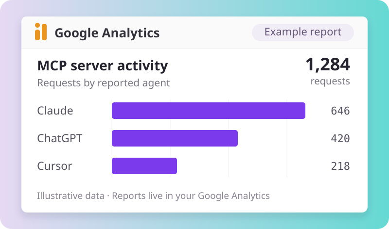

# MCP Analytics for GA4

**See how AI assistants use your MCP server, directly in Google Analytics 4.**

MCP Analytics for GA4 is an open source Java library that sends request counts, tool usage and reported agent names to your own GA4 account. Add it to your existing server with Gradle or Maven. No hosted collector or separate analytics dashboard to run.

[](https://github.com/Locusive/mcp-analytics-ga4/actions/workflows/ci.yml)
[Maven Central 0.1.1](https://central.sonatype.com/artifact/io.github.shanifdhanani/mcp-analytics-ga4/0.1.1) · Java 17+ · [Apache 2.0](LICENSE)



*Illustrative report with synthetic data. Your reports live in your Google Analytics account; setup instructions are included.*

[Product page](https://locusive.com/mcp-analytics/) · [Quickstart](#quickstart) · [GA4 graph setup](docs/GA4_CHROME_SETUP.md) · [Runnable sample](docs/SAMPLE_SERVER.md) · [Event reference](docs/EVENT_SCHEMA.md)

## What you can measure

| Question | What MCP Analytics for GA4 records |
|---|---|
| How much is my MCP server used? | Protocol request counts over time, with notifications counted separately. |
| Which tools are used? | Tool-call counts by tool name, request outcome and duration. |
| Which agents are calling? | Reported clients such as Claude, ChatGPT, Claude Code, Cowork and Cursor, plus recognized bots and health checks. |
| How did they find my server? | Explicit source/campaign tags or available referrer-host evidence. Missing discovery information stays unknown. |
| What happened afterward? | Optional application hooks for accepted searches, messages, link opens, carts, views and attributed orders. |

Request tracking extracts metadata from the request and safe header fields. Downstream outcomes require hooks in your own application: a completed tool call cannot establish that someone opened a result or purchased. [Metric coverage and exact formulas](docs/SHOP_NOBI_METRIC_COVERAGE.md) explain the distinction.

## Migrating from the original name

This project was previously called Agent Analytics. Replace `io.github.shanifdhanani:mcp-ga4:0.1.0` with `io.github.shanifdhanani:mcp-analytics-ga4:0.1.1`. Use only the new dependency. Java packages (`ai.nobi.mcp.ga4`), public APIs, environment variables and GA4 event names are unchanged, so existing integrations and reports keep working. The original Maven artifact remains available and the old GitHub URL redirects here.

## Quickstart

Requires Java 17+ and a GA4 web stream.

### 1. Add the dependency

Version `0.1.1` is [published on Maven Central](https://central.sonatype.com/artifact/io.github.shanifdhanani/mcp-analytics-ga4/0.1.1).

```groovy
repositories { mavenCentral() }
dependencies { implementation 'io.github.shanifdhanani:mcp-analytics-ga4:0.1.1' }
```

<details>
<summary>Maven</summary>

```xml
<dependency>
  <groupId>io.github.shanifdhanani</groupId>
  <artifactId>mcp-analytics-ga4</artifactId>
  <version>0.1.1</version>
</dependency>
```

</details>

### 2. Configure Google Analytics

Find your web stream's measurement ID and create a Measurement Protocol API secret. Supply them through your existing server secret mechanism:

| Environment variable | Value |
|---|---|
| `GA4_MEASUREMENT_ID` | Your web stream's `G-...` measurement ID |
| `GA4_API_SECRET` | Its private Measurement Protocol API secret |

[The setup guide](docs/GA4_CHROME_SETUP.md) covers these steps and the custom dimensions, metrics and graphs. You can give it to Claude or ChatGPT in a session with authorized Chrome control. Keep the API secret on your server and out of chat, source control and browser code.

### 3. Instrument your request handler

Create one sender when your application starts. Call the hook once after each JSON-RPC request or notification completes, including errors.

```java
import ai.nobi.mcp.ga4.Ga4Client;
import ai.nobi.mcp.ga4.Ga4Config;
import ai.nobi.mcp.ga4.tracking.McpAnalytics;
import ai.nobi.mcp.ga4.tracking.TrackingContext;

Ga4Client ga4 = new Ga4Client(Ga4Config.builder()
        .measurementId(System.getenv("GA4_MEASUREMENT_ID"))
        .apiSecret(System.getenv("GA4_API_SECRET"))
        .build());
McpAnalytics analytics = new McpAnalytics(ga4);

// Use your application's shutdown lifecycle to drain queued events.
Runtime.getRuntime().addShutdownHook(new Thread(ga4::close));

// In your existing request handler, after the request completes:
TrackingContext context = TrackingContext.builder()
        .serverName("catalog-server")
        .build();

// These values come from your handler. Inspect MCP errors as well as HTTP status.
analytics.request(context, parsedRequest, headers, outcome, elapsedMillis);
```

This hook works with an existing Java MCP framework or custom handler. It performs no network I/O on the request thread. `request(...)` returns whether the event entered the local queue; monitor that result and `ga4.stats()` for dropped or failed events.

For older MCP clients, retain the reported initialize client name and supply `agentName(...)` on later requests. Newer per-request `_meta["io.modelcontextprotocol/clientInfo"]` metadata is also supported. Pass the same resolved agent and attribution context to search and downstream hooks. Agent identity is reported metadata, not proof of a model or person.

If you have a stable, non-personal caller identity, supply `clientId(...)`. Otherwise the library uses a shared per-process fallback that preserves request totals but cannot establish visitor counts. [Identity and counting rules](docs/EVENT_SCHEMA.md) cover browser joins, sessions and correlation IDs.

## Try the sample

Clone this repository, configure the two environment variables above, then run:

```bash
./gradlew check
./gradlew :sample-server:run
```

The sample starts at `http://127.0.0.1:8099/mcp`. [Follow its walkthrough](docs/SAMPLE_SERVER.md) to run tool calls, open returned links and generate synthetic outcomes. Use a development GA stream. Local HTTP tests run without Google credentials.

## Counting and reporting

Requests, tool calls, AI query activities, accepted searches and messages are separate counts. Notifications do not inflate the request metric. Repeated link opens count as clicks, while CTR uses **distinct accepted searches with a qualifying click / accepted searches**.

The included Chrome guide creates GA request, tool, agent, source and outcome reports. Exact visitor conversion, multi-day click attribution and same-browser conversation counts need your application's identity signals and the joins in [the BigQuery export queries](docs/queries.sql). The coverage guide documents every supported input and denominator; it does not imply that those downstream hooks are already wired in a particular application.

Google describes Measurement Protocol as an addition to browser/app tracking, with partial reporting for server-only use. GA user, session and acquisition reports do not automatically identify people or reconstruct MCP discovery. [Google's documentation](https://developers.google.com/analytics/devguides/collection/protocol/ga4)

## Privacy and delivery

Query text and prompts are excluded by default. The explicit search hook sends a query hash for correlation; hashing is not anonymization, so exclude personal information before calling it. Redacted query text is opt-in. Transport session IDs are always hashed, and raw authorization headers, IP addresses, tool arguments and results are not collected. [Security and privacy](SECURITY.md)

Delivery uses a bounded in-memory queue with no retries or durable storage. `flush(Duration)` waits for terminal delivery outcomes; an HTTP success means receipt, not confirmed GA processing. Monitor accepted, delivered, rejected and failed counts, close the sender during graceful shutdown, and verify actual received events in GA. Use a host-managed durable outbox if you need stronger delivery guarantees.

## Built with Nobi

MCP Analytics for GA4 grew out of measuring how AI assistants use **[Nobi](https://nobi.ai)** and **[Shop Nobi](https://nobi.ai/shop)**. We are sharing the instrumentation as a standalone open source Java library.

- **[Nobi](https://nobi.ai)** brings semantic and conversational search to websites and online stores.
- **[Shop Nobi](https://nobi.ai/shop)** lets shoppers search across stores and buy directly from the merchant.
- **[Locusive](https://locusive.com)** is home to these products and our broader software portfolio.

## Documentation and contributing

- [GA4 setup for humans and Chrome-capable agents](docs/GA4_CHROME_SETUP.md)
- [Event schema and application hooks](docs/EVENT_SCHEMA.md)
- [Metric coverage and exact formulas](docs/SHOP_NOBI_METRIC_COVERAGE.md)
- [Sample server and controlled verification](docs/SAMPLE_SERVER.md)
- [GA BigQuery export queries](docs/queries.sql)
- [Contributing](CONTRIBUTING.md) and [release procedure](docs/PUBLISHING.md)

## License

[Apache License 2.0](LICENSE), including its patent grant. Google Analytics, MCP, Claude and ChatGPT are third-party products; this project is not endorsed by their owners.
